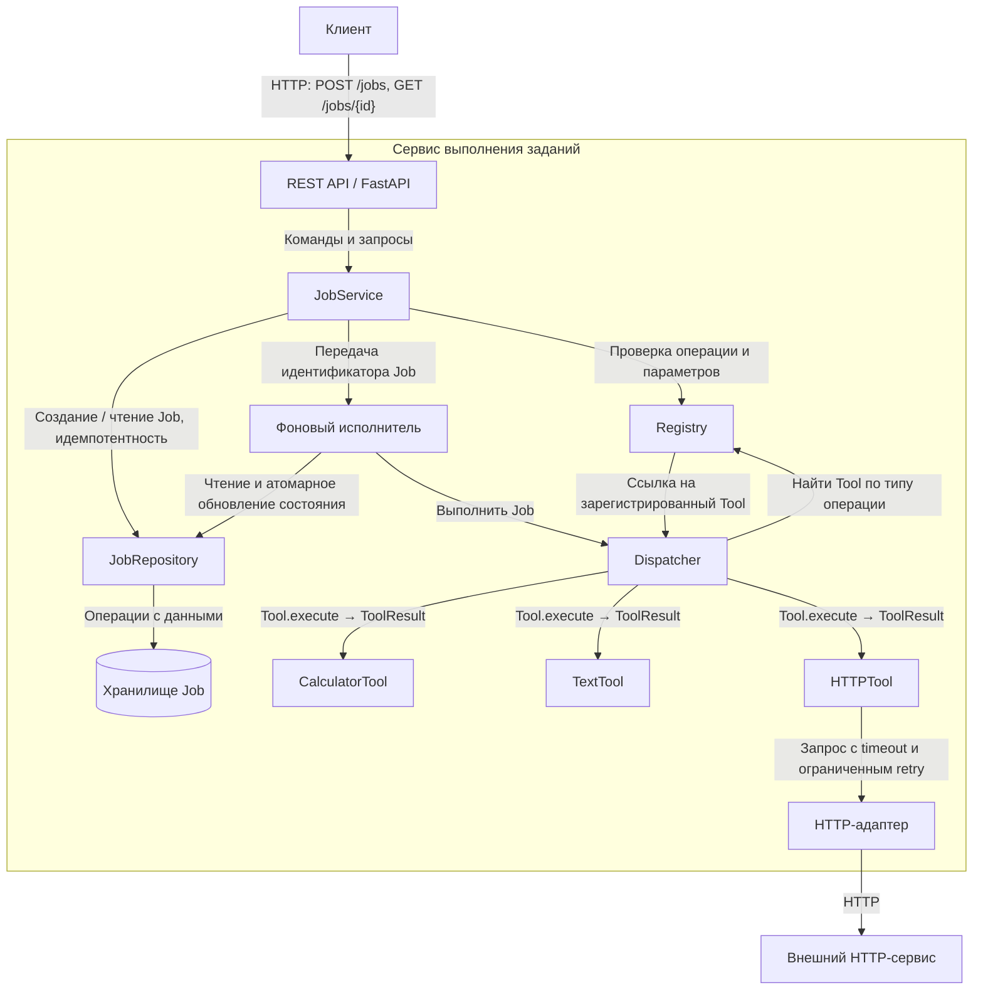
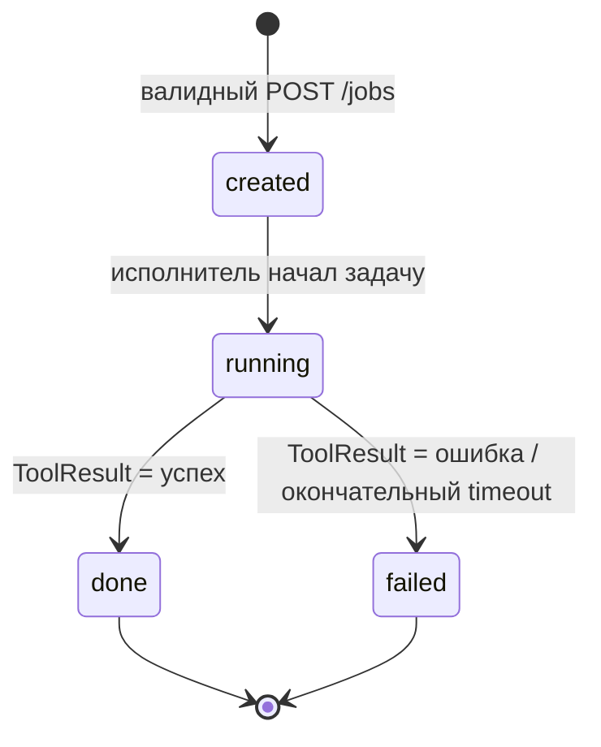

# Архитектура сервиса выполнения заданий

## 1. Назначение и границы

Сервис предоставляет клиентским приложениям единый REST API для создания вычислительных, текстовых и HTTP-задач, отслеживания их состояния и получения результата по идентификатору Job. Внутренние обработчики подключаются через общий контракт Tool. В P2 описывается проектируемая архитектура; реализация её компонентов предусмотрена последующими практиками.

## 2. Контекст системы (C4 — Context)

**Смысл стрелок:** стрелки обозначают сетевые вызовы во время работы системы, а не зависимости исходного кода. Сервис скрывает от клиента выбор обработчика, управление жизненным циклом Job и способ хранения результатов. Внешний HTTP-сервис находится вне границ разрабатываемой системы.

## 3. Диаграмма компонентов

**Смысл стрелок:** стрелки внутри системы показывают вызовы компонентов через предусмотренные интерфейсы (не прямое обращение к внутренним полям). Стрелки между клиентом и API, а также между адаптером и внешним сервисом — сетевые вызовы. Стрелка к хранилищу — доступ к данным через `JobRepository`, а не из Dispatcher или Tool.

### Ответственность и скрываемые детали

| Компонент | Отвечает за | Скрывает от соседей |
|---|---|---|
| REST API | HTTP-маршруты, сериализацию JSON, коды ответов, единый формат ошибок | Детали HTTP и FastAPI от доменного ядра |
| JobService | Создание и поиск задач, валидацию операции и параметров до создания Job, идемпотентность | Правила работы с Job от транспортного слоя |
| Фоновый исполнитель (Worker) | Получение Job, запуск работы и сохранение итогового состояния | Механизм фонового запуска и конкуренции |
| JobRepository | Создание, чтение, атомарное изменение Job и хранение результатов | SQL, СУБД, транзакции и схему таблиц |
| Хранилище Job | Постоянное хранение задач, ошибок и результатов | Физическую организацию данных за интерфейсом репозитория |
| Dispatcher | Вызов выбранного Tool через общий контракт и получение ToolResult | Конкретные реализации операций от Worker |
| Registry | Регистрацию и поиск Tool по имени операции | Устройство перечня доступных обработчиков |
| CalculatorTool | Математические операции | Алгоритмы вычислений за интерфейсом Tool |
| TextTool | Преобразование текста | Правила текстовых преобразований за интерфейсом Tool |
| HTTPTool | Выполнение внешней HTTP-операции и перевод результата в ToolResult | Особенности внешнего провайдера от Dispatcher |
| HTTP-адаптер | Сетевые вызовы, timeout, ограниченный retry, проверку формата ответа | Протокол и ошибки конкретного внешнего сервиса от HTTPTool |

**Границы зависимостей:** Dispatcher не использует SQL или HTTP напрямую. Tool не знает о таблицах Job, а REST API не выбирает конкретный Tool. Переходы состояния Job проверяются доменной моделью; репозиторий сохраняет изменения атомарно.

## 4. Диаграмма состояний Job

### Разрешённые переходы

| Откуда | Куда | Причина |
|---|---|---|
| `created` | `running` | Исполнитель атомарно взял задачу в работу |
| `running` | `done` | Tool успешно завершил операцию, результат сохранён |
| `running` | `failed` | Tool завершился ошибкой или исчерпаны допустимые повторные попытки |

### Запрещённые переходы и ответ системы

- Переходы `created → done`, `created → failed` и `running → created` не предусмотрены договорённым жизненным циклом.
- Переходы из `done` или `failed` в любое рабочее состояние запрещены: это терминальные состояния. Повторный запуск завершённой Job по тому же `id` не допускается.
- Внутренняя попытка запрещённого перехода отклоняется доменной моделью с ошибкой `INVALID_STATE_TRANSITION`; исходное состояние сохраняется. Если такая попытка вызывается поддерживаемой HTTP-командой, API возвращает `409 Conflict` в едином формате ошибки.
- `GET /jobs/{id}` не изменяет состояние. Для неизвестного идентификатора API возвращает `404 Not Found`.
- Неизвестная операция или неверные параметры в `POST /jobs` возвращают `400 Bad Request` до создания Job.
- Повтор `POST /jobs` с тем же `Idempotency-Key` и идентичным запросом возвращает существующую Job без нового выполнения; тот же ключ с другими параметрами возвращает `409 Conflict`.

### Сбои и границы гарантий

Если внешняя операция завершилась неопределённо (например, провайдер выполнил действие, но ответ потерялся), нельзя автоматически обещать отсутствие повторного внешнего эффекта. Это отдельно фиксируется в контракте HTTP Tool и ADR о фоновой обработке/повторах. После перезапуска процесса обнаруженные «зависшие» задачи `running` требуют явной политики восстановления, чтобы избежать двойного вызова внешнего сервиса.

## 5. Связь с документами P2

- Машиночитаемые HTTP-операции и единый формат ошибок — `docs/api/openapi.yaml`.
- Интерфейс `Tool`, структура `ToolResult` и примеры двух реализаций — `docs/tool-contract.md`.
- Обоснование фонового исполнения и идемпотентности — `docs/adr/`.
- Проверка поведения для K1–K10 и допущений — `docs/contract-check.md`.
